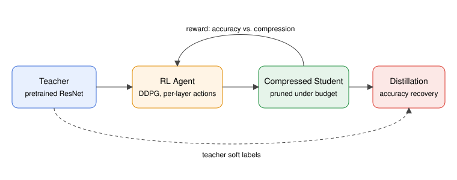

# Neural Algorithm Distiller (NAD)
# System Architecture

## 1. Overview

Neural Algorithm Distiller (NAD) is an experimental deep-learning framework exploring reinforcement-learning-guided neural network compression.

The system combines a Teacher–Student learning architecture, a Deep Deterministic Policy Gradient (DDPG) controller, structured channel pruning, and knowledge distillation.

The primary objective is to investigate how reinforcement learning can guide neural network compression while maintaining predictive performance.

---

## 2. High-Level Architecture

The conceptual NAD workflow consists of the following components:

1. Teacher Network
2. Student Network
3. DDPG Controller
4. Compression Environment
5. Structured Pruning
6. Knowledge Distillation
7. Model Evaluation

### Architecture Diagram

---

## 3. Teacher Network

The Teacher Network acts as the reference model in the compression framework.

It provides predictive information that can guide the learning process of the smaller Student Network.

### Responsibilities

- Provide reference predictions.
- Supply teacher information for knowledge distillation.
- Serve as a baseline for evaluating compression.
- Help assess the predictive performance of the compressed model.

The project uses a ResNet-56-style architecture in its CIFAR-oriented experimental setup.

---

## 4. Student Network

The Student Network is the compact neural network being optimized.

It undergoes structured pruning and knowledge distillation to investigate whether a smaller architecture can retain useful predictive capability.

### Responsibilities

- Receive structural compression.
- Learn from teacher guidance.
- Reduce model complexity.
- Maintain competitive predictive performance.

The student architecture is evaluated against the reference model using consistent evaluation metrics.

---

## 5. DDPG Controller

NAD explores Deep Deterministic Policy Gradient (DDPG) as the reinforcement learning controller.

DDPG is an actor-critic algorithm designed for continuous action spaces.

The controller interacts with the compression environment to explore compression decisions.

### Conceptual Responsibilities

- Observe the compression state.
- Generate compression actions.
- Interact with the compression environment.
- Receive feedback from the environment.
- Improve its compression policy through reinforcement learning.

The controller provides an adaptive decision-making mechanism for the compression workflow.

---

## 6. Compression Environment

The Compression Environment provides the interaction boundary between the DDPG controller and the neural network compression process.

It represents the current compression state and evaluates the actions selected by the controller.

### Conceptual Responsibilities

- Represent the current model compression state.
- Receive actions from the reinforcement learning controller.
- Evaluate compression decisions.
- Provide feedback for subsequent controller decisions.

The environment enables the controller to explore different compression strategies.

---

## 7. Structured Channel Pruning

Structured pruning is used to investigate reducing neural network complexity by removing groups of parameters.

Unlike unstructured pruning, which removes individual weights, structured pruning targets components such as channels.

### Objectives

- Reduce parameter count.
- Reduce computational complexity.
- Produce a more compact network architecture.
- Investigate deployment efficiency.

The resulting Student Network is evaluated to understand the relationship between compression and predictive performance.

---

## 8. Knowledge Distillation

Knowledge distillation transfers information from a larger Teacher Network to a smaller Student Network.

The teacher provides guidance during student training.

### Objectives

- Preserve useful predictive information.
- Improve student learning.
- Support compact model development.
- Investigate accuracy retention after compression.

Knowledge distillation is an important part of the Teacher–Student learning strategy.

---

## 9. Overall Workflow

The conceptual workflow can be summarized as follows:

### Stage 1 — Reference Model
Establish the Teacher Network as the reference model.

### Stage 2 — Reinforcement Learning
The DDPG controller interacts with the compression environment.

### Stage 3 — Compression Decisions
The controller explores compression actions.

### Stage 4 — Structured Pruning
Selected compression decisions are applied to the Student Network.

### Stage 5 — Knowledge Distillation
The student learns using teacher guidance.

### Stage 6 — Evaluation
The resulting model is evaluated using predictive performance and computational efficiency metrics.

---

## 10. Evaluation Metrics

NAD investigates model compression using several evaluation metrics.

| Metric | Purpose |
|---|---|
| Accuracy | Measures predictive performance |
| Parameters | Measures model complexity |
| FLOPs / MACs | Estimates computational requirements |
| Compression Ratio | Measures relative model reduction |
| Inference Latency | Measures execution time |

All measurements should use a documented and consistent evaluation protocol.

---

## 11. Visualization and Monitoring

NAD includes an experiment dashboard for visualizing project information.

The dashboard is intended to provide insight into:

- Teacher and Student model information.
- Compression activity.
- Reinforcement learning decisions.
- Model efficiency measurements.
- Experimental results.

Visualizations should represent actual model activity and measured values rather than simulated or randomly generated information.

---

## 12. Technology Stack

| Component | Technology |
|---|---|
| Programming Language | Python |
| Deep Learning | PyTorch |
| Computer Vision | TorchVision |
| Network Architecture | ResNet |
| Reinforcement Learning | DDPG |
| Model Optimization | Structured Pruning |
| Learning Strategy | Knowledge Distillation |
| Dashboard | Streamlit |
| Data Analysis | NumPy, Pandas, Matplotlib |

---

## 13. Architecture Design Principles

The project explores the following principles:

**Adaptive Compression**

Investigating reinforcement learning as an alternative to exclusively fixed compression strategies.

**Knowledge Transfer**

Using teacher guidance to support student learning.

**Computational Efficiency**

Evaluating reductions in model parameters and computational complexity.

**Performance Preservation**

Studying the trade-off between compression and predictive accuracy.

**Observability**

Providing visibility into actual model activity and experimental outcomes.

---

## 14. Implementation and Intellectual Property

This document presents the conceptual system architecture for research communication and professional demonstration.

The following implementation details are intentionally excluded:

- Internal Python source code.
- DDPG actor and critic implementations.
- Private environment state representations.
- Internal reward calculations.
- Pruning implementation details.
- Training scripts and configurations.
- Model checkpoints and proprietary weights.

The underlying implementation is maintained separately in a private repository.

---

## 15. Conclusion

Neural Algorithm Distiller explores the integration of reinforcement learning, structured neural network pruning, and knowledge distillation.

By combining adaptive compression decisions with teacher-guided student learning, NAD investigates approaches to developing computationally efficient deep learning models.

The project provides a research-oriented framework for studying the relationship between model complexity, predictive performance, and computational efficiency.

---

**Project:** Neural Algorithm Distiller  
**Developer:** ZeroDawnDev  
**Category:** Artificial Intelligence / Deep Learning / Reinforcement Learning
