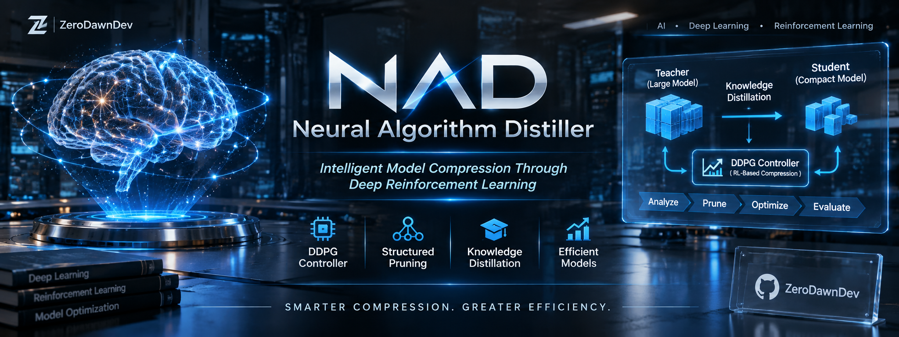
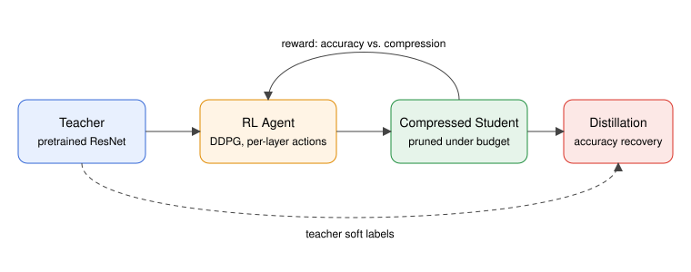
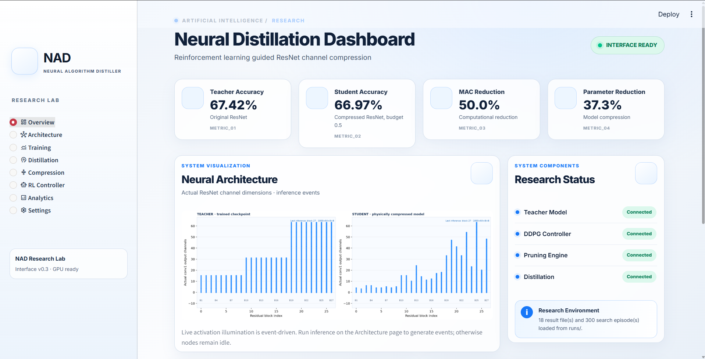

# Neural Algorithm Distiller (NAD)

### Reinforcement Learning-Driven Neural Network Compression
 

  
 

  <strong>Intelligent Model Compression Through Deep Reinforcement Learning</strong>

  AI Research | Deep Learning | Reinforcement Learning | Model Optimization

---

## Overview

**Neural Algorithm Distiller (NAD)** is an experimental AI research project exploring the use of Deep Reinforcement Learning to guide neural network compression.

The framework investigates how a reinforcement learning controller can make adaptive compression decisions while preserving the predictive capability of a neural network.

NAD combines three central concepts:

- **Deep Reinforcement Learning:** Uses a Deep Deterministic Policy Gradient (DDPG) controller to guide compression decisions.
- **Structured Pruning:** Reduces neural network complexity through channel-level compression.
- **Knowledge Distillation:** Transfers knowledge from a larger Teacher Network to a smaller Student Network.

The objective is to explore the balance between model efficiency and predictive performance.

---

## Research Motivation

Modern deep learning models can require substantial computational resources.

This creates challenges when deploying models in environments with limited memory, processing power, or computational budgets.

NAD explores an adaptive approach to neural network compression in which reinforcement learning guides the compression process rather than relying exclusively on fixed pruning strategies.

### Research Objectives

- Investigate reinforcement learning for adaptive neural network compression.
- Explore automated channel-pruning decisions.
- Reduce model parameters and computational complexity.
- Preserve predictive performance through knowledge distillation.
- Evaluate compression and accuracy trade-offs.

---

## System Architecture

NAD follows a Teacher–Student architecture supported by a reinforcement learning controller.

### Core Components

| Component | Description |
|---|---|
| Teacher Network | Reference neural network providing predictive guidance |
| Student Network | Compact neural network being optimized |
| DDPG Controller | Reinforcement learning agent responsible for compression decisions |
| Compression Environment | Manages the interaction between the controller and compression process |
| Structured Pruning | Reduces network complexity through channel removal |
| Knowledge Distillation | Transfers knowledge from teacher to student |
| Evaluation System | Measures predictive performance and computational efficiency |

---

## Reinforcement Learning Approach

NAD explores Deep Deterministic Policy Gradient (DDPG), an actor-critic reinforcement learning algorithm designed for continuous action spaces.

The controller interacts with a compression environment to explore compression decisions.

The conceptual workflow involves:

1. Observing the current compression state.
2. Selecting a compression action.
3. Applying the corresponding compression decision.
4. Evaluating the resulting model.
5. Using feedback to improve future decisions.

This creates an adaptive optimization process for exploring neural network compression.

---

## Teacher–Student Learning

The framework investigates knowledge distillation to help a smaller student network retain useful information from a larger teacher network.

The Teacher Network acts as the reference model, while the Student Network learns under the guidance of the teacher.

The purpose is to investigate whether a compressed model can maintain competitive predictive performance with fewer computational resources.

---

## Structured Channel Pruning

NAD investigates structured pruning as a way to reduce neural network complexity.

Instead of removing individual weights independently, structured pruning targets groups of parameters such as network channels.

Potential benefits include:

- Reduced parameter count.
- Lower computational requirements.
- More compact model architecture.
- Improved suitability for resource-constrained deployment.

Actual performance improvements must be established through evaluation.

---

## Technology Stack

| Category | Technologies |
|---|---|
| Programming | Python |
| Deep Learning | PyTorch |
| Computer Vision | TorchVision |
| Neural Networks | ResNet |
| Reinforcement Learning | DDPG |
| Optimization | Structured Pruning |
| Training | Knowledge Distillation |
| Visualization | Streamlit |
| Experiment Analysis | NumPy, Pandas, Matplotlib |

---

## Project Demonstration

### NAD Dashboard

*Replace this image with a screenshot from the actual NAD application.*

### Model Visualization

*Add an authentic visualization of the Teacher and Student networks.*

### Experimental Results

*Add verified experimental results when available.*

---

## Performance Evaluation

NAD evaluates model compression through multiple measurements.

| Evaluation Metric | Purpose |
|---|---|
| Model Accuracy | Measures predictive performance |
| Parameter Count | Measures model size in parameters |
| FLOPs / MACs | Estimates computational complexity |
| Compression Ratio | Measures reduction relative to baseline |
| Inference Latency | Measures execution time |

For verified experimental measurements, see [RESULTS.md](RESULTS.md).

No unverified performance claims are presented in this showcase.

---

## Research Scope

The project focuses on investigating the relationship between:

- Reinforcement learning and neural network compression.
- Structured pruning and computational efficiency.
- Knowledge distillation and predictive performance.
- Model complexity and deployment considerations.

The project is experimental, and its effectiveness should be assessed using documented benchmarks.

---

## Project Roadmap

- [x] Teacher–Student framework exploration
- [x] DDPG-based compression controller development
- [x] Structured pruning implementation
- [x] Knowledge distillation integration
- [x] Experiment visualization dashboard
- [ ] Extended experimental evaluation
- [ ] Additional compression benchmarks
- [ ] Deployment-oriented performance analysis
- [ ] Further optimization experiments

---

## Repository Contents

This repository is dedicated to project presentation and technical documentation.

It contains:

- Research overview
- Conceptual architecture
- Technical documentation
- Dashboard screenshots
- Demonstration materials
- Verified experimental results

**The internal implementation and proprietary source code are maintained separately and are not included in this repository.**

---

## Intellectual Property

Neural Algorithm Distiller is an original research and engineering project developed under the ZeroDawnDev identity.

This public repository is intended for project presentation, research communication, and professional portfolio purposes.

The underlying implementation, proprietary algorithms, internal configurations, and model weights are not distributed here.

All rights reserved unless otherwise stated.

---

## Author

**ZeroDawnDev**

Artificial Intelligence | Deep Learning | Software Engineering

GitHub: [@ZeroDawnDev](https://github.com/ZeroDawnDev)

---

  <strong>Neural Algorithm Distiller</strong>
   
  Exploring intelligent approaches to efficient deep learning.

